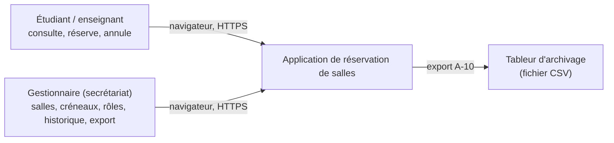
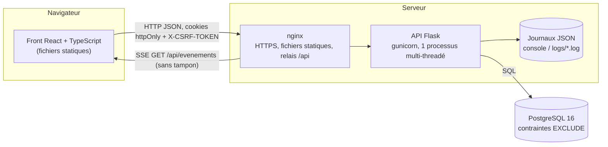
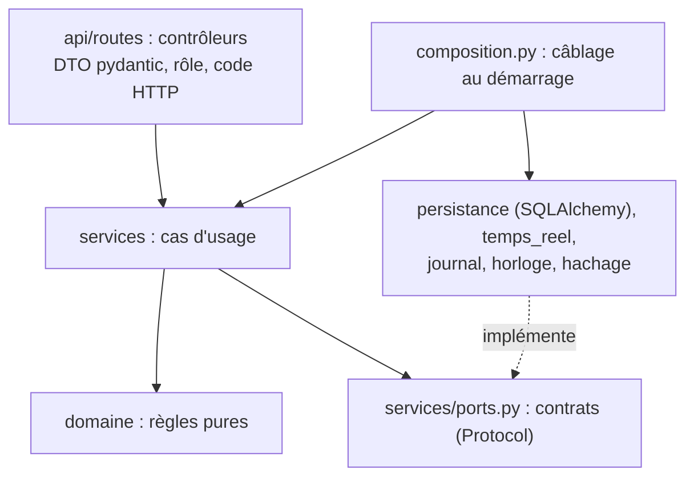
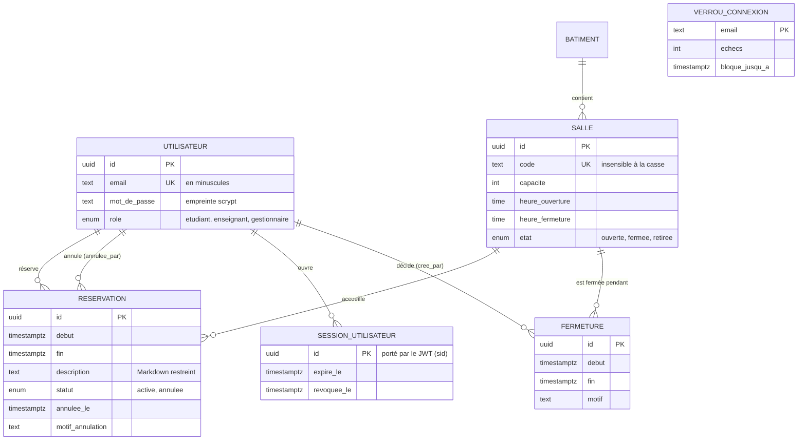
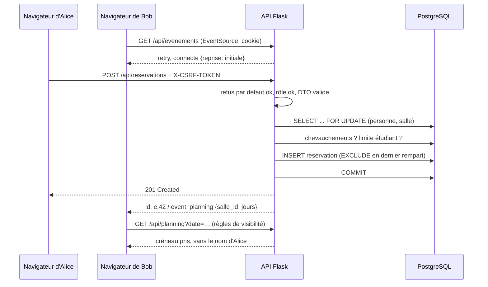

# Architecture

Schémas du système, du plus large au plus précis (niveaux « contexte » et « conteneurs » du
modèle C4, puis modèle de données et séquence d'un cas d'usage). Les diagrammes sont écrits
en Mermaid : GitLab les affiche directement, VS Code avec l'extension « Markdown Preview
Mermaid Support ».

## Contexte

Hors périmètre : notifications par courriel, emploi du temps, matériel des salles.

## Conteneurs

Front et API partagent la même origine : les cookies `SameSite=Strict` suffisent, aucun CORS.

## Couches de l'API

Les flèches pleines sont des dépendances de code : elles vont toutes vers le domaine et les
contrats. Les services ne dépendent ni de Flask, ni de SQLAlchemy, ni de `logging` ; leurs
dépendances arrivent par le constructeur (`composition.py` en production, dépôts en mémoire
dans `tests/unitaires/faux.py`).

## Modèle de données

Invariants tenus par la base (`db/schema.sql`), en plus du code : pas deux réservations
actives qui se chevauchent sur une salle, ni pour une même personne (`EXCLUDE USING gist`
sur `tstzrange`), pas deux fermetures qui se chevauchent, et une réservation terminée ou
annulée ne se modifie plus (déclencheur `reservation_historique_immuable`).

## Séquence : réserver, puis diffuser (A-02, A-03, A-04)

Si la connexion de Bob tombe, le navigateur se reconnecte avec `Last-Event-ID: e.42` : les
événements suivants sont rejoués s'ils sont encore dans l'historique, sinon le message
`connecte` porte `reprise: impossible` et le front recharge le planning.
